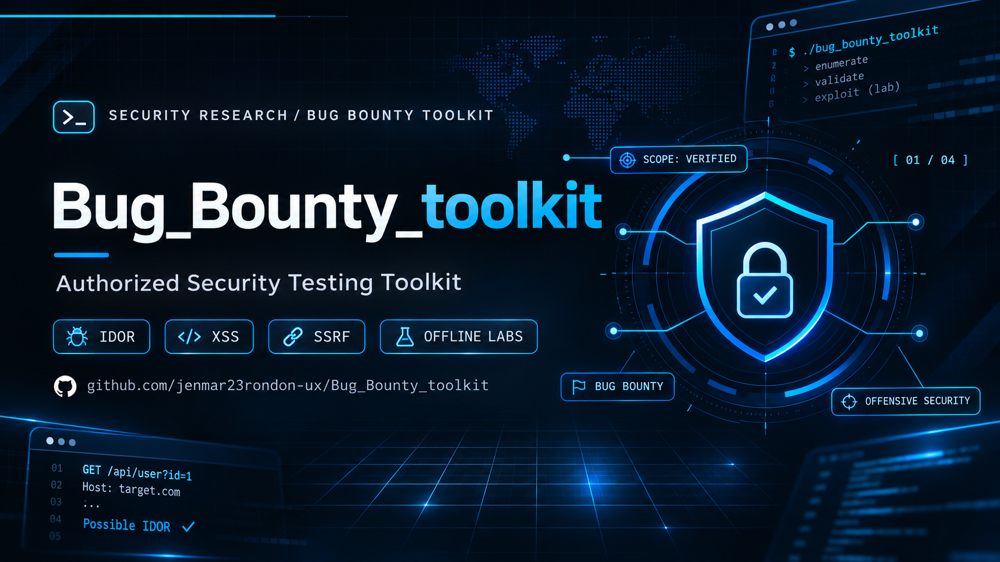
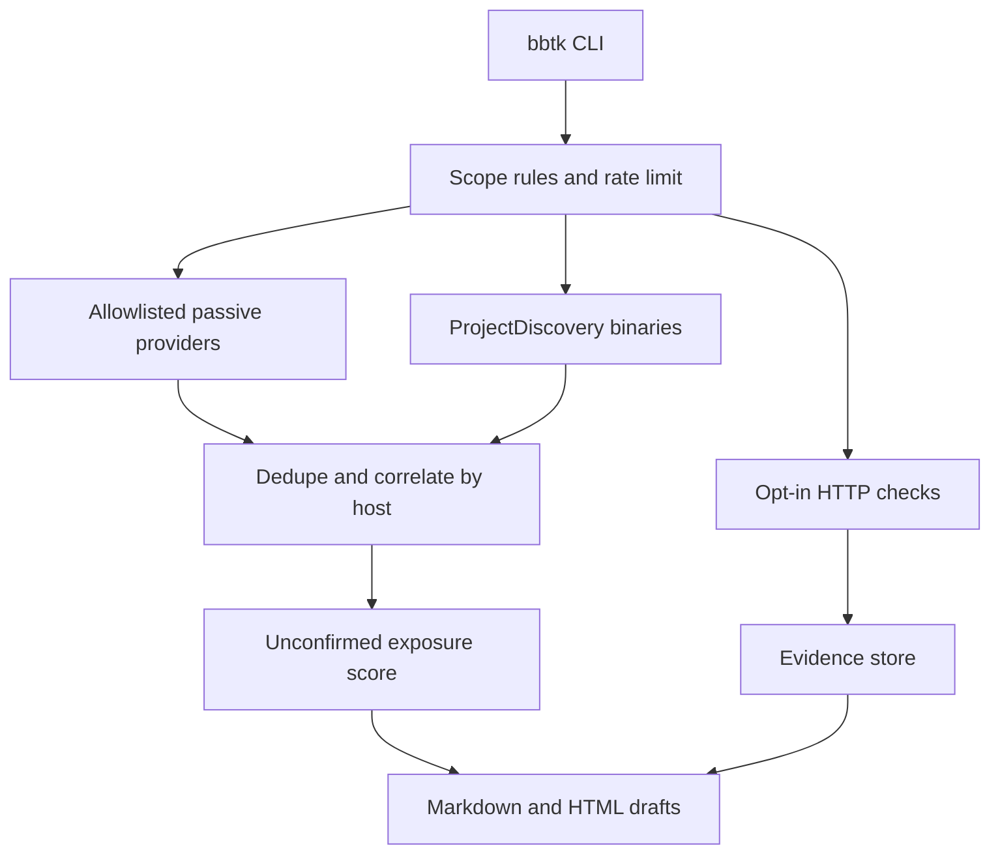

<p align="center">
  
</p>

# Bug Bounty Toolkit

Authorized testing CLI (`bbtk` / `bugbounty`) for asset discovery, evidence collection, and report drafts. Version **0.3.0**.

## Ethics and authorization

Use this toolkit only with written permission for every asset you test. You supply the program's in-scope and out-of-scope rules. A target is contacted only when an allow rule matches and no exclusion matches. Exclusions win, including wildcard exclusions such as `!*.admin.example.com`.

The toolkit does not submit reports to HackerOne or any other platform. Active probing is off unless you pass `--active --confirm`. Nuclei also requires `--nuclei`, and its default invocation disables update checks and interactsh and excludes the `dos`, `intrusive`, and `fuzz` tags.

## Quickstart

```bash
python -m venv .venv
source .venv/bin/activate          # Windows PowerShell: .venv\Scripts\Activate.ps1
python -m pip install -e ".[dev]"
bbtk doctor                        # offline; no HTTP
bbtk init acme --authorization "HackerOne program, automation permitted" --automation-allowed
bbtk scope add acme example.com
bbtk scope add acme '*.example.com'
bbtk scope add acme --exclude admin.example.com
bbtk recon acme --target example.com --dry-run
bbtk recon acme --target example.com
bbtk add-finding acme --finding-id F-1 --title "Title" --category information-disclosure \
  --severity low --target https://app.example.com/ --summary "What you observed." \
  --steps "Authorized requests only." --impact "What an unauthorized user could do." \
  --remediation "The control that should exist." --cvss 5.3
bbtk report acme --finding-id F-1 --format markdown
bbtk report acme --finding-id F-1 --format html
```

`--dry-run` prints the recon plan and contacts nobody. A live passive run queries allowlisted providers only: crt.sh, Cert Spotter, the Wayback Machine, AlienVault OTX, HackerTarget, and urlscan. Shodan InternetDB is used when the target is an in-scope IPv4 address. SecurityTrails and VirusTotal are included when `SECURITYTRAILS_API_KEY` or `VIRUSTOTAL_API_KEY` is set; those keys are sent as headers and are not copied into reports.

`subfinder` and `amass` run on a live recon when they are installed. `dnsx` and `httpx` run only with `--active --confirm`. Every external binary is an allowlisted argv executed without a shell. If a binary is missing, recon names it and continues with the sources that are available.

Passive provider traffic is capped at 1 request per second or the program rate, whichever is slower. Set the program rate in the settings file written by `bbtk init` (`requests_per_second`, default 1).

Windows can run scope checks, passive recon planning, and report drafts. Workflows that publish private artifacts use POSIX no-follow file descriptors and fail closed on Windows; use Linux or WSL for those paths. See [docs/quickstart.md](docs/quickstart.md).

## Architecture



Passive providers never use the target as the request host. Tool output is filtered through the same scope rules before it is stored. Scores cap at medium and stay unconfirmed.

## Features

These commands exist and behave as described:

- **Scope.** `scope add` and `scope import` store allow and exclude rules. Exact hosts do not authorize subdomains. `*.example.com` does. A public-suffix wildcard such as `*.com` or `*.co.uk` is rejected. Alternate IP spellings (`2130706433`, `127.1`, `0x7f000001`) collapse to one address. Path exclusions are case-insensitive.
- **Passive recon.** `recon` collects names and historical URLs, tags each with its source, drops anything out of scope, and writes `reports/recon.md`, `reports/recon.html`, and `reports/recon.json`.
- **Optional active tools.** `--active --confirm` runs `dnsx` and `httpx` on the in-scope host list. `--nuclei` adds a conservative Nuclei pass. `scan nuclei --confirm` is the standalone scanner and uses the same limits.
- **HTTP checks.** `request`, `hunt`, `xss`, `sqli`, `cors-check`, `ssrf-check`, `open-redirect`, `csrf-audit`, and `access-check` send traffic only to in-scope URLs, with a rate limit and a response-size cap. Redirects are not followed. A DNS name that resolves to a non-public address is refused unless that address is an explicit scope entry.
- **Evidence and review.** Burp and HAR import, object and IDOR discovery, an evidence ledger, and offline labs (`bbtk lab idor`, `bbtk lab web-vuln`) operate on local fixtures.
- **Reports.** `report --finding-id` writes a draft with title, severity, CVSS, affected asset, summary, steps to reproduce, impact, evidence, and remediation. Program HTML and JSON reports summarize recorded runs. Nothing is submitted for you.

`bbtk fuzz` and other active checks stay opt-in behind their own confirmation flags. `tool-plan` prints a command and does not execute it.

## Confirmation bar (one screen)

| State | Meaning |
| --- | --- |
| **confirmed** | Second independent proof for that check (see table). |
| **candidate** | Single signal; not reportable as confirmed. |
| **not_observed** | No signal in this run. |
| **inconclusive** | Incomplete / blocked / unverified. |
| **rejected** | Recorded reason: `false_positive`, `out_of_scope`, or `no_second_proof`. |

What reaches **confirmed** vs stays **candidate**:

| Check | Confirmed only if | Candidate / never confirmed |
| --- | --- | --- |
| CORS | Native probes do not prove private browser-readable data | Reflected policy remains candidate, even with cookies and a body |
| Open redirect | Native probes do not establish parameter causality | Matching external `Location` remains candidate; redirects are not followed |
| SSRF | Lab loopback canary received the request | URL-looking param alone |
| CNAME takeover | — | **Never** confirmed; max candidate with dangling + known fingerprint + unclaimed |
| IDOR/BOLA | Session B reads/writes A’s resource, session control proven, both responses in evidence | Weaker evidence |
| XSS reflected | `--confirm-exec` Playwright observes the marker or an alert after that marker was reflected | Reflection without execution |
| XSS DOM | `--dom`, or `--dom-local` (loopback-only alias): attributed execution of this probe's marker (`window.__bbtk_xss_marker` or an alert whose text is exactly that marker) **and** that same marker reached an instrumented DOM sink | A sink without execution, DOM reflection without execution (`reflected_not_executed`), an unrelated alert or marker, or execution without a sink |
| SQLi | A boolean true/false body delta reproduces twice, and the baseline request between those pairs matches the first baseline | Errors, timing deltas, UNION differences, a DBMS fingerprint, and a boolean delta that is not reproduced. A changed intervening baseline is inconclusive and is not confirmed |

`bbtk hunt` runs `cors-check`, `ssrf-check`, `open-redirect`, `xss`, `sqli`, `access-check`. Each preserves its own evidence threshold. Use standalone `csrf-audit` and `takeover-check` outside hunt. See [HTTP proof limits](docs/http-proof-attribution.md).

Recon exposure scores are not part of this bar. They are triage signals and are never confirmed findings.

## Offline labs

```bash
bbtk lab idor --dry-run
bbtk lab web-vuln --dry-run
python -m unittest discover -s tests -v
```

Labs are synthetic or loopback. Doctor, unit tests, and dry-run planning do not need the Internet.

## More docs

- [docs/quickstart.md](docs/quickstart.md) — environment setup, including Windows limits
- [docs/authorized-testing.md](docs/authorized-testing.md) — authorization expectations
- [docs/HUNT.md](docs/HUNT.md) — hunt workflow and pre-submit checklist
- [docs/external-tool-policy.md](docs/external-tool-policy.md) — subprocess allowlist, timeouts, and scope attestation
- [External importers](docs/external-importers.md) — offline Nuclei, ZAP, FFUF, and SQLMap results as unconfirmed hypotheses
