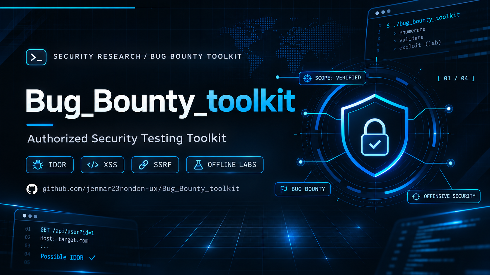

<p align="center">
  
</p>

# Bug Bounty Toolkit

Authorized testing CLI (`bbtk` / `bugbounty`). You supply targets, routes, and parameters. Version **0.2.2**.

## Install

```bash
python -m venv .venv && source .venv/bin/activate
python -m pip install -e .
bbtk --version
bbtk doctor   # offline; no HTTP
```

Optional: `pip install -e ".[dashboard,xss,sqli,csrf,takeover,dev]"`. See [docs/quickstart.md](docs/quickstart.md).

## Confirmation bar (one screen)

| State | Meaning |
| --- | --- |
| **confirmed** | Second independent proof for that check (see table). |
| **candidate** | Single signal; not reportable as confirmed. |
| **not_observed** | No signal in this run. |
| **inconclusive** | Incomplete / blocked / unverified. |
| **rejected** | Recorded reason: `false_positive`, `out_of_scope`, or `no_second_proof`. |

What reaches **confirmed** vs stays **candidate**:

| Check | Confirmed only if | Candidate / never confirmed |
| --- | --- | --- |
| CORS | Native probes do not prove private browser-readable data | Reflected policy remains candidate, even with cookies and a body |
| Open redirect | Native probes do not establish parameter causality | Matching external `Location` remains candidate; redirects are not followed |
| SSRF | Lab loopback canary received the request | URL-looking param alone |
| CNAME takeover | — | **Never** confirmed; max candidate with dangling + known fingerprint + unclaimed |
| IDOR/BOLA | Session B reads/writes A’s resource, session control proven, both responses in evidence | Weaker evidence |
| XSS reflected | `--confirm-exec` Playwright observes the marker or an alert after that marker was reflected | Reflection without execution |
| XSS DOM | `--dom`, or `--dom-local` (loopback-only alias): attributed execution of this probe's marker (`window.__bbtk_xss_marker` or an alert whose text is exactly that marker) **and** that same marker reached an instrumented DOM sink | A sink without execution, DOM reflection without execution (`reflected_not_executed`), an unrelated alert or marker, or execution without a sink |
| SQLi | A boolean true/false body delta reproduces twice, and the baseline request between those pairs matches the first baseline | Errors, timing deltas, UNION differences, a DBMS fingerprint, and a boolean delta that is not reproduced. A changed intervening baseline is inconclusive and is not confirmed |

`bbtk hunt` runs `cors-check`, `ssrf-check`, `open-redirect`, `xss`, `sqli`, `access-check`. Each preserves its own evidence threshold. Use standalone `csrf-audit` and `takeover-check` outside hunt. See [HTTP proof limits](docs/http-proof-attribution.md).

XSS and SQLi evidence records where the probe was placed (`query`, `body_form`, `body_json`, or `header`). A result with no parameter location is **inconclusive** and is not confirmed. Browser confirmation of a POST body is unsupported, because the browser does not replay that body: the result is **inconclusive** and is not confirmed. Query and header confirmation still require the second independent proof in the table above.

SQLi is confirmed only by that repeated boolean delta. One boolean difference, a SQL error, a timing delay, a UNION-shaped difference, or a MySQL/PostgreSQL/MSSQL/Oracle/SQLite error fingerprint is evidence and stays a candidate. The fingerprint is recorded and never promotes a result. `--bypass` sends at most 15 packaged payloads and is off unless requested; those payloads do not confirm.

## Hunt (authorized)

1. Load **your** program’s written scope into `scope.yaml` / `scope.txt`.
2. Run `bbtk hunt <program> ... --dry-run` first; then bounded live runs only on authorized assets.
3. Promote candidate → confirmed only when the bar above is met; otherwise do not report as confirmed.
4. You close and submit the report yourself. See [docs/HUNT.md](docs/HUNT.md) and [reports/template.md](reports/template.md).

## Offline labs

```bash
bbtk lab idor --dry-run
bbtk lab web-vuln --dry-run
python -m unittest discover -s tests -v
```

Labs are synthetic/loopback. No internet required for doctor, unit tests, or dry-run planning.

## Scope, rate limit, dry-run

Every active check still enforces scope validation, rate limits, and `--dry-run`. Evidence keeps `candidate` / `not_observed` / `inconclusive` when confirmation is not met.

## More docs

- [docs/HUNT.md](docs/HUNT.md) — one-page hunt workflow and pre-submit checklist
- [docs/authorized-testing.md](docs/authorized-testing.md) — authorization expectations
- [docs/quickstart.md](docs/quickstart.md) — environment setup
- [Incremental platform audit](docs/advanced-research-audit.md) — existing engines, capture-status regressions, measured benchmark and platform limits
- [External importers](docs/external-importers.md) — offline Nuclei, ZAP, FFUF, and SQLMap results as unconfirmed hypotheses


## Business-logic planner

`bbtk analyze business-logic` builds an offline candidate test plan from HAR/captures. See docs/business-logic-planner.md.
